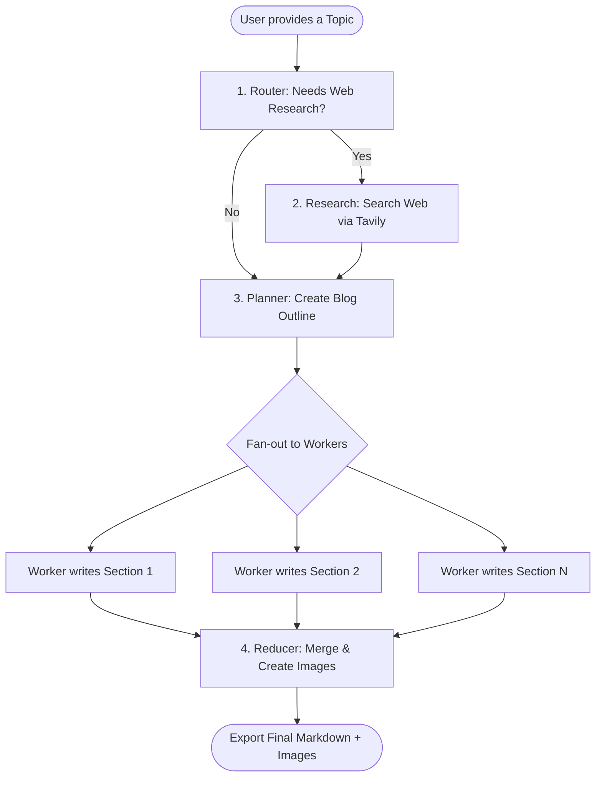
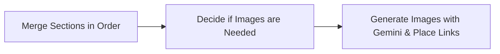

# 🤖 Technical Blog Writing Agent

An AI assistant built with **LangGraph**, **LangChain**, and **Streamlit** that helps you research, outline, write, and create images for technical blog posts.

Instead of writing an entire article in one big prompt (which often leads to made-up facts or repetitive text), this agent breaks the job down into steps: it checks if web research is needed, creates a detailed outline, writes sections in parallel, adds relevant diagrams/images, and saves everything neatly in Markdown.

---

## 📌 Table of Contents

- [What This Agent Does](#-what-this-agent-does)
- [How It Works (Flow Diagrams)](#-how-it-works-flow-diagrams)
- [Models & Services Used](#-models--services-used)
- [How the Backend Works (`blog_writing_backend.py`)](#-how-the-backend-works-blog_writing_backendpy)
- [The Frontend Dashboard (`blog_writing_frontend.py`)](#-the-frontend-dashboard-blog_writing_frontendpy)
- [Project Structure](#-project-structure)
- [Getting Started & How to Run](#-getting-started--how-to-run)
- [Helpful Built-in Protections](#-helpful-built-in-protections)

---

## 💡 What This Agent Does

1. **Smart Routing**: Checks your topic to see if it needs fresh web research (e.g., latest news or pricing) or if it's a timeless concept (like how algorithms work).
2. **Web Search & Fact Checking**: Uses the Tavily Search API to find real articles, removes duplicate links, and passes real sources to the writer.
3. **Structured Outline**: Plans the post with titles, target word counts, key bullet points, and notes on where code examples are needed.
4. **Fast Parallel Writing**: Writes all sections at the same time using worker agents, saving time.
5. **Clean Section Merging**: Puts the sections back in the correct order based on the initial outline.
6. **Automatic Diagrams & Images**: Finds where diagrams would help the reader, creates images using Google Gemini (`gemini-2.5-flash-image`), saves them in an `images/` folder, and adds them directly to the Markdown file.

---

## 🏗️ How It Works (Flow Diagrams)

### Main Workflow



### Image & Merging Steps



---

## 🧠 Models & Services Used

| Feature | Model / Service | What it does |
| :--- | :--- | :--- |
| **Main Brain (Default)** | OpenAI `gpt-4.1-mini` | Handles routing, planning, section writing, and image ideas in `blog_writing_backend.py`. |
| **Alternative Brain** | Groq `openai/gpt-oss-120b` | High-speed alternative backend with custom token limits in `blog_backend_using_groq.py`. |
| **Web Search** | Tavily Search API | Finds accurate links and articles on the internet. |
| **Image Generator** | Google Gemini (`gemini-2.5-flash-image`) | Creates technical diagrams and visual assets. |

---

## ⚙️ How the Backend Works (`blog_writing_backend.py`)

The backend is built with LangGraph to coordinate each step and pass data smoothly between tasks.

### 1. The Shared State
A shared dictionary keeps track of everything as the agent runs:

```python
class State(TypedDict):
    topic: str
    mode: str                  # "closed_book", "hybrid", or "open_book"
    evidence: List[EvidenceItem]
    plan: Optional[Plan]
    sections: Annotated[List[tuple[int, str]], operator.add]  # Collects written sections
    merged_md: str
    image_specs: List[dict]
    final: str
```

---

### 2. The Main Steps (Nodes)

* **Router (`router_node`)**: Looks at the topic and chooses a mode:
  * `closed_book`: Evergreen fundamentals (no web search needed).
  * `hybrid`: General topics that need recent examples (searches recent weeks).
  * `open_book`: Fast-moving news or updates (searches the last 7 days).
* **Research (`research_node`)**: Runs Tavily web searches, cleans up duplicate links, and collects verified source URLs.
* **Planner (`orchestrator_node`)**: Breaks down the topic into 4–8 clear sections with target word counts and goals.
* **Workers (`worker_node`)**: Each section is assigned to a worker that writes Markdown content, adds required code snippets, and includes links to the research sources.
* **Reducer Subgraph (`reducer_subgraph`)**:
  1. Combines all sections in the right order.
  2. Decides if 1–2 visual diagrams will help explain the topic.
  3. Uses Google Gemini to generate the images, saves them locally to `./images/`, and inserts them into the document.

---

## 💻 The Frontend Dashboard (`blog_writing_frontend.py`)

A user-friendly Streamlit web app to run and watch the agent work:

* **Live Progress**: Shows each step updating in real time.
* **Organized Tabs**:
  * **Summary**: Word counts, character stats, and routing mode.
  * **Research**: See the search queries and source links found by Tavily.
  * **Outline**: View the planned sections, bullet points, and word targets.
  * **Article Preview**: Read the final post with embedded images and code formatting.
* **1-Click Download**: Download a `.zip` file containing your `.md` blog post and the generated images.

---

## 📂 Project Structure

```text
blog-writing-agent/
│
├── blog_writing_backend.py      # Main LangGraph agent (OpenAI + Gemini + Tavily)
├── blog_backend_using_groq.py   # Alternative agent using Groq
├── blog_writing_frontend.py     # Streamlit web app
│
├── images/                      # Folder where generated diagrams are saved
├── blog_practice_ipynb_codes/   # Jupyter notebooks showing step-by-step evolution
│   ├── blog_basic.ipynb
│   ├── blog_improved_prompting.ipynb
│   ├── blog_improvedNew_prompting.ipynb
│   ├── blog_research.ipynb
│   ├── blog_with_image_groqAi.ipynb
│   └── blog_with_image_original.ipynb
│
├── requirements.txt             # Project dependencies
├── pyproject.toml               # Environment configuration
└── README.md                    # Project documentation
```

---

## 🚀 Getting Started & How to Run

### 1. Install Dependencies

```bash
# Clone the repository
git clone https://github.com/vijayypandit/Blog-writing-Ai-Agent.git
cd Blog-writing-Ai-Agent

# Create and activate a virtual environment
python -m venv .venv
# On Windows: .\.venv\Scripts\Activate.ps1
# On Mac/Linux: source .venv/bin/activate

# Install required packages
pip install -r requirements.txt
```

### 2. Set Up API Keys

Create a `.env` file in the main folder with your keys:

```env
OPENAI_API_KEY=your_openai_api_key
GOOGLE_API_KEY=your_gemini_api_key      # For Gemini image generation
TAVILY_API_KEY=your_tavily_api_key      # For web search
GROQ_API_KEY=your_groq_api_key          # (Optional) Only needed for Groq backend
```

### 3. Launch the Web App

```bash
streamlit run blog_writing_frontend.py
```

Open `http://localhost:8501` in your browser, enter a topic, and click **Generate Blog**.

### 4. Run from Python Code (Optional)

```python
from blog_writing_backend import app

# Run the agent directly
result = app.invoke({"topic": "How Vector Databases Work"})
print(result["final"])
```

---

## 🛡️ Helpful Built-in Protections

* **Image Fallback**: If image generation fails or hits an API limit, the agent places a clean note in the Markdown instead of stopping or crashing.
* **No Fake Citations**: If web search finds no sources, the agent simply writes without citations rather than making up fake links.
* **Safe Filenames**: File titles are automatically converted into safe names (e.g., `how_vector_databases_work.md`) to avoid saving errors on Windows, Mac, or Linux.
