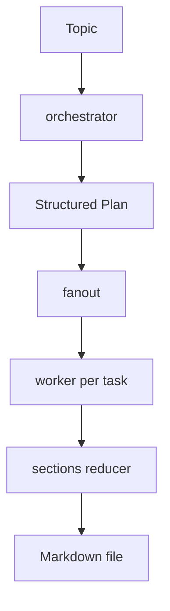
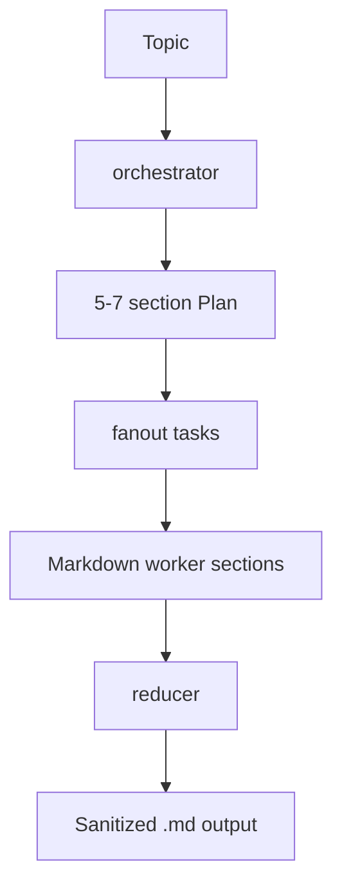
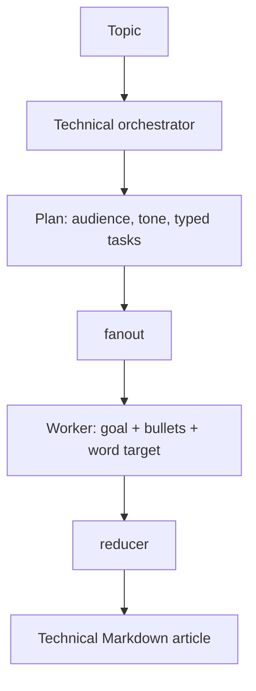
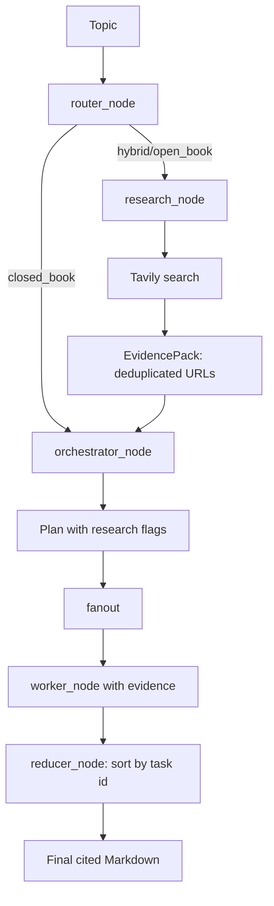
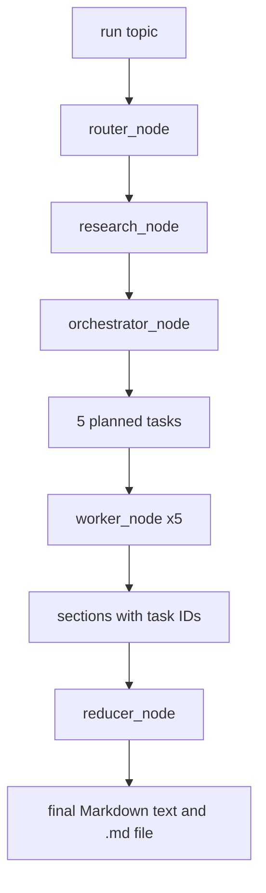

# 📝 Blog Writing Agent

A small LangChain + LangGraph workspace that turns a topic into a structured blog plan, writes sections through worker nodes, and saves the final article as Markdown. The notebooks show the workflow evolving from a basic writer into a research-aware technical writing agent.

## Contents 📚

- [Project Structure](#project-structure)
- [Notebook Features](#notebook-features)
- [Common Workflow](#common-workflow)
- [Setup and Run](#setup-and-run)
- [Troubleshooting](#troubleshooting)

## Project Structure

```text
blog-writing-agent/
├── _bwa_basic.ipynb
├── _bwa_improved_prompting.ipynb
├── _bwa_improvedNew_prompting.ipynb
├── _bwa_research.ipynb
├── building_reliable_llm_powered_features_from_prompt_design_to_production_observability.md
├── designing_a_production_ready_retrieval_augmented_generation_service_with_llms.md
├── understanding_self_attention_in_transformers_a_comprehensive_guide.md
├── pyproject.toml
├── requirements.txt
└── README.md
```

| File | Purpose and added feature |
| --- | --- |
| [`_bwa_basic.ipynb`](_bwa_basic.ipynb) | First working graph: plan, fan-out, section workers, reducer, and Markdown output. |
| [`_bwa_improved_prompting.ipynb`](_bwa_improved_prompting.ipynb) | Stronger prompts, clearer Markdown rules, safer filenames, and a 1,000+ word example. |
| [`_bwa_improvedNew_prompting.ipynb`](_bwa_improvedNew_prompting.ipynb) | Schema-driven technical writing with audience, tone, goals, bullets, word targets, section types, and a required common-mistakes section. |
| [`_bwa_research.ipynb`](_bwa_research.ipynb) | Research-aware writing with routing, Tavily search, evidence extraction, citation rules, blog kinds, and deterministic section ordering. |
| [`pyproject.toml`](pyproject.toml) | Project metadata, Python version (`>=3.14`), and declared dependencies. |
| [`requirements.txt`](requirements.txt) | Installable dependency list for the notebook environment. |
| [`understanding_self_attention_in_transformers_a_comprehensive_guide.md`](understanding_self_attention_in_transformers_a_comprehensive_guide.md) | Generated/reference article about self-attention and Transformers. |
| [`building_reliable_llm_powered_features_from_prompt_design_to_production_observability.md`](building_reliable_llm_powered_features_from_prompt_design_to_production_observability.md) | Research/reference notes on reliable LLM features, prompts, orchestration, observability, and safety. |
| [`designing_a_production_ready_retrieval_augmented_generation_service_with_llms.md`](designing_a_production_ready_retrieval_augmented_generation_service_with_llms.md) | Research/reference notes on RAG, grounding, latency, cost, and hallucination control. |
| [`README.md`](README.md) | Project map, feature history, execution flow, setup, and troubleshooting. |

## Notebook Features 🧪

### 1. Basic writer

The basic notebook defines `Task`, `Plan`, and `State`, then uses `orchestrator`, `fanout`, `worker`, and `reducer` functions. The reducer joins generated sections and saves a lowercase, space-normalized Markdown filename.



### 2. Improved prompting

This version keeps the same graph but makes planning and section prompts more explicit. It requests Markdown-ready headings, controls the article length, and sanitizes the output filename with a regular expression.



### 3. Structured technical writer

`_bwa_improvedNew_prompting.ipynb` adds richer task contracts: `goal`, 3-5 `bullets`, `target_words`, and `section_type`. The planner also captures `audience` and `tone`, while workers request code, examples, trade-offs, failure modes, and implementation details where relevant.



### 4. Research-aware writer

`_bwa_research.ipynb` is the newest feature. `router_node` chooses `closed_book`, `hybrid`, or `open_book`; research-enabled topics call Tavily through `_tavily_search`, normalize and deduplicate evidence, and pass source URLs to the planner and workers. Citation requirements prevent unsupported fresh claims from being presented as facts.



## Common Workflow 🔄

All versions use the same LangGraph pattern:

1. Load environment variables and initialize `ChatGroq`.
2. Ask the LLM for a structured plan.
3. Use `Send` to create one worker task per planned section.
4. Collect section results through an `Annotated` list reducer.
5. Join sections and write a `.md` file.

The research version adds a router and evidence stage before planning. Its `run(topic)` helper initializes state and invokes the compiled graph.

## Setup and Run 🚀

1. Create a Python 3.14+ environment.
2. Install dependencies:

   ```bash
   pip install -r requirements.txt
   ```

3. Add a `.env` file in the project folder:

   ```env
   GROQ_API_KEY=your_groq_key
   TAVILY_API_KEY=your_tavily_key
   ```

   `TAVILY_API_KEY` is needed only when the research notebook routes a topic to web research.
4. Open a notebook in VS Code, run cells from top to bottom, and invoke its final runner cell. Generated Markdown is written to the notebook's current working directory.

## Troubleshooting 🛠️

**Why does the notebook say the API key is missing?**

Check that `.env` is in the working directory and that the variable name is exactly `GROQ_API_KEY`. Restart the kernel after changing it.

**Why does research fail while basic writing works?**

Confirm `TAVILY_API_KEY` is set and that `langchain-tavily` and `tavily-python` are installed. Closed-book topics can run without Tavily.

**Why is the output file in an unexpected folder?**

The notebooks use `Path.cwd()`. Check the notebook kernel's current working directory before running the final cell.

**Why are citations missing?**

Only evidence URLs passed to the research worker may be cited. If Tavily returns no usable results, the model is instructed to state that sources were not found rather than inventing one.

**Why can section order vary?**

The basic notebooks collect sections as they finish. The research notebook returns `(task.id, section)` pairs and sorts them in `reducer_node`, so its final order follows the plan.

## Sample Run Explained 🔎

The last notebook cell ran `run("State of LLM developed and live in 2026")`. The returned dictionary shows how the graph completed:

1. **Input**: `run(topic)` creates the initial state with the topic and empty research fields.
    Example: `topic = "State of LLM developed and live in 2026"`.
2. **Router**: `router_node` classified the topic as `open_book` and set `needs_research=True` because it asks about current 2026 information.
    Example: `mode = "open_book"`.
3. **Research**: `research_node` created several web queries and attempted Tavily searches.
    Example: `queries = ["Which large language models were released or updated between 2025 and 2026..."]`.
    In this run, `evidence = []`, so no source URLs were available for grounding.
4. **Planning**: `orchestrator_node` generated a structured plan with five tasks, including deployment, cost, security, and observability.
    Example: `Task(id=2, title="Live Deployment Patterns & Serving Infrastructure")`.
5. **Fan-out**: `fanout` sent each task to a separate `worker_node`.
    Example: task 2 received its title, goal, bullets, audience, tone, and research evidence.
6. **Writing**: each worker generated one Markdown section.
    Example: `sections = [(1, "## Recent Model Releases..."), (2, "## Live Deployment Patterns...")]`.
7. **Reducing**: `reducer_node` sorted sections by task ID, joined them, and created the final document.
    Example: `final = "# State of LLM Development and Live Deployment in 2026\\n\\n## Recent Model Releases..."`.
8. **File output**: the reducer writes the final text to a file named from the blog title and returns it in `out["final"]`.



## At a Glance ✅

This repository demonstrates a clear progression: simple orchestration -> better prompting -> typed technical plans -> optional web research and grounded citations. It is intentionally notebook-sized, making each function and graph edge easy to inspect and extend.
