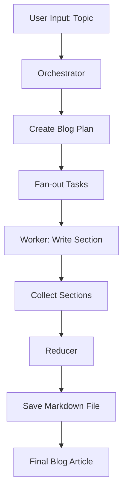

# 📝 Blog Writing Agent

A beginner-friendly project that uses an LLM-driven agent workflow to turn a topic into a structured blog plan, generate article sections, and combine them into a final Markdown article.

This project is designed as an experimentation workspace for building a multi-step writing pipeline with LangChain and LangGraph. It is intentionally simple, readable, and easy to extend as more advanced features are added.

---

## 🌟 Project Goal

The goal of this agent is to:

- accept a blog topic
- create a structured plan with multiple sections
- assign each section to a worker node
- generate content for each section using an LLM
- merge the sections into a final blog article
- save the final article as a Markdown file

This gives a clean foundation for building a more advanced research-based writing system later.

---

## 📁 Project Structure

```text
blog-writing-agent/
├── .env                           # Local environment variables (API keys) 
├── .venv/                         # Local Python virtual environment
├── _bwa_basic.ipynb               # Basic version of the agent workflow
├── _bwa_improved_prompting.ipynb # Improved prompting version
├── _bwa_improvedNew_prompting.ipynb
├── pyproject.toml                 # Project metadata and dependencies
├── requirements.txt               # Dependency list used in the environment
├── uv.lock                        # Lock file generated by uv
├── understanding_self_attention_in_transformers_a_comprehensive_guide.md
│                                 # Example article or study material
└── README.md                      # Project documentation
```

### 📦 Key Files Explained

- `.env`  
  Stores local environment secrets such as API keys. Keep this file private and do not commit real credentials.

- `pyproject.toml`  
  Declares the project metadata and the dependencies used by the project.

- `requirements.txt`  
  A simple dependency list for installing the project packages into the environment.

- `uv.lock`  
  Keeps a pinned dependency lock so the project can be reproduced consistently.

- `_bwa_basic.ipynb`  
  The first working version of the writing agent. Good starting point to understand the workflow.

- `_bwa_improved_prompting.ipynb`  
  Improves how the model is prompted and structured for better output quality.

- `_bwa_improvedNew_prompting.ipynb`  
  A newer revision that continues experimentation with prompts, planning, and workflow patterns.

- `understanding_self_attention_in_transformers_a_comprehensive_guide.md`  
  A reference article or conceptual study file related to transformer architecture and attention.

---

## 🧠 What the Agent Is Doing

This project follows a classic agent-orchestration pattern:

1. The user provides a topic.
2. The orchestrator asks the model to generate a structured blog plan.
3. Each plan item becomes a task.
4. A worker node writes one section for each task.
5. The reducer combines all sections into one final Markdown document.
6. The file is saved to the project folder.

The workflow is built using LangGraph, where each node handles a specific part of the job.

---

## 🔄 Agent Flow



### Step-by-step breakdown

#### 1) Orchestrator
The orchestrator node uses the LLM to create a plan such as:

- blog title
- 5 to 7 sections
- each section with a title and brief description

It uses a structured output model so the result is predictable and easy to process.

#### 2) Fan-out
Once the plan is ready, the system fans out each task into a worker node. This allows multiple section-writing tasks to happen independently.

#### 3) Worker
Each worker receives:

- the topic
- the blog title
- the specific section task
- the section brief

The LLM then writes the actual Markdown section content.

#### 4) Reducer
The reducer gathers all generated sections and combines them into a single article.

It creates a final Markdown document like:

```md
# Title

## Section 1
...

## Section 2
...
```

Then it saves the file as a clean `.md` file in the workspace.

---

## 🧩 Main Code Pattern

The core pattern used in the notebooks is:

- `StateGraph` from LangGraph for workflow orchestration
- `START` and `END` for graph edges
- `Send` to fan out work to multiple workers
- `TypedDict` to model state
- `Annotated[List[str], operator.add]` to combine generated section results

This makes the project a great introduction to agentic workflows in Python.

---

## 🏗️ Why This Structure Works

This project is designed to teach the principles of agentic writing:

- planning before writing
- breaking work into smaller tasks
- parallel execution of tasks
- combining outputs into a final artifact
- keeping the workflow modular and understandable

It is a strong example of how a simple writing agent can evolve into a more advanced research assistant.

---

## 🚀 Recommended Learning Path

For beginners, start in this order:

1. Open `_bwa_basic.ipynb`
2. Understand how the LLM is initialized
3. Study the `State` object and plan generation
4. Look at the `worker` function
5. Understand how the `reducer` assembles the final content
6. Then explore the improved notebooks for better prompting patterns

This sequence helps build understanding from simple to advanced patterns.

---

## 🔮 Future Improvements Planned

This project is intentionally a strong foundation for future enhancements. Upcoming improvements may include:

- research layer before writing
- citation retrieval from sources
- fact-checking and validation step
- structured outline templates for different content types
- SEO optimization and keyword planning
- multi-agent reviewer/editor workflow
- blog generation from external documents or web research
- CLI or Streamlit interface for non-technical users

These improvements will make the system more robust, research-backed, and production-ready.

---

## ✅ Summary

This repository provides a practical and beginner-friendly example of a blog-generation agent built with:

- Python
- LangChain
- LangGraph
- Groq LLM
- Markdown output generation
- structured planning and worker-based execution

It demonstrates a clear and teachable workflow that can easily grow into a more complete AI content platform.

---

## 🙌 Notes

The current implementation is a solid starting point, and the project is intentionally structured for future growth. The next commits can add more research depth, better validation, and more production-grade workflow logic.

If you are learning LLM workflows or agent-based systems, this project is a good hands-on example to build from.
