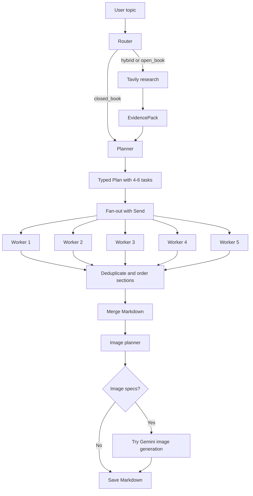

# Blog Writing Agent: Current Workflow

This guide explains the current image-enabled blog-writing workflow in [`_bwa_with_image.ipynb`](_bwa_with_image.ipynb).

The agent accepts a topic, decides whether research is needed, creates a blog plan, writes sections in parallel, merges the sections, and optionally adds images to the final Markdown file.

## Flow Diagram



## What Each Stage Does

1. **Router** classifies the topic:
   - `closed_book`: evergreen topics such as self-attention.
   - `hybrid`: mostly evergreen topics that benefit from current models, tools, or examples.
   - `open_book`: time-sensitive topics involving latest releases, prices, regulations, or rankings.
2. **Research** sends selected queries to Tavily and converts the results into typed evidence items containing URLs and snippets.
3. **Planner** creates a typed `Plan` with the blog title, audience, tone, blog kind, and usually 4-6 tasks.
4. **Fan-out** sends each task to a separate worker using LangGraph `Send`.
5. **Workers** write one Markdown section each using the task goal, bullets, target word count, citation rules, and available evidence.
6. **Reducer** deduplicates sections by task ID, restores their planned order, and joins them into one article.
7. **Image planner** returns only image metadata. The full article is kept local so the model does not have to reproduce a large Markdown document.
8. **Image generation** tries Gemini for each proposed image. If Gemini is unavailable or over quota, the article remains readable and receives a fallback error block.

## What `run()` Returns

The final notebook input is:

```json
{
   "topic": "LLM 2026"
}
```

The returned dictionary contains the state of the workflow:

| Field | Meaning |
| --- | --- |
| `topic` | The original user topic. |
| `mode` | `closed_book`, `hybrid`, or `open_book`. |
| `needs_research` | Whether web research was requested. |
| `queries` | Search questions created by the router. |
| `evidence` | Normalized research results. |
| `plan` | The blog outline and its tasks. |
| `sections` | Worker results as `(task_id, markdown)` pairs. |
| `merged_md` | The ordered article before image placement. |
| `image_specs` | Image prompts, filenames, captions, alt text, and dimensions. |
| `final` | The final Markdown text written to disk. |

## Explaining the `LLM 2026` Sample

The sample run produced this high-level state:

```text
topic          = "LLM 2026"
mode           = "hybrid"
needs_research = True
evidence       = 2 source items
plan.tasks     = 5 tasks
image_specs    = 3 image proposals
```

### 1. Router result

Because `LLM 2026` depends on current information, the router selected `hybrid` mode and enabled research. It proposed queries about model releases, MoE architectures, open-source projects, regulation, multimodal models, hardware, costs, and benchmarks.

The notebook intentionally limits the actual Tavily call to the first two queries and one result per query. This keeps token use and API cost predictable. Therefore, ten planned queries can still produce only two evidence items.

### 2. Research result

The sample returned two sources, including a TechTarget model overview and an architecture article. These sources are passed to the planner and workers for fresh claims and citations.

Research is grounding, not a replacement for editorial review. Claims about future models, parameters, prices, licensing, and benchmarks should still be checked before publication.

### 3. Plan result

The planner created five tasks:

1. 2026 LLM ecosystem and architecture trends.
2. Choosing the right model for a use case.
3. A minimal integration and streaming code example.
4. Performance and cost benchmarking.
5. Production debugging and observability.

Every task contains a goal, concrete bullets, a target word count, tags, and flags such as `requires_code` or `requires_citations`.

### 4. Worker result

Each worker returns a Markdown section such as:

```text
## 2026 LLM Ecosystem at a Glance

...section content...
```

The `sections` list stores the task ID together with the generated Markdown. This allows the reducer to restore the planned order even when workers finish at different times.

The sample showed task 2 with an empty section. This means the workflow completed, but the article is incomplete. Before publishing, check for empty sections and retry or reject them.

### 5. Final Markdown and images

The reducer joins the non-empty sections into `merged_md`. The image planner then proposes diagrams such as:

- dense versus MoE architecture;
- throughput versus batch size;
- a model-selection decision matrix.

The sample's Gemini image calls failed because the project had a free-tier quota of `0`. The fallback behavior inserted the image caption, alt text, prompt, and error into the Markdown instead of stopping the whole workflow. Actual PNG files require an image API project with available quota.

## Setup and Run

1. Create a Python 3.14+ environment.
2. Install the dependencies:

   ```bash
   pip install -r requirements.txt
   ```

3. Create a `.env` file in the project directory:

   ```env
   GROQ_API_KEY=your_groq_key
   TAVILY_API_KEY=your_tavily_key
   GOOGLE_API_KEY=your_google_key
   ```

   `TAVILY_API_KEY` is needed for research-enabled topics. `GOOGLE_API_KEY` is needed only for Gemini image generation.

4. Open [`_bwa_with_image.ipynb`](_bwa_with_image.ipynb) in VS Code.
5. Run the notebook definition cells from top to bottom.
6. Run the final cell with a topic:

   ```python
   run("LLM 2026")
   ```

The Markdown output is saved in the notebook's current working directory. Generated images are saved under `images/` when image generation succeeds.

## Token and Rate-Limit Controls

The notebook uses smaller limits because the Groq organization has an 8,000-token-per-minute limit:

- shared planning and routing client: `max_tokens=1800`;
- individual worker calls: `max_tokens=900`;
- research: at most two queries and one result per query;
- image planning: only a short article excerpt is sent, and only image metadata is returned.

If Groq returns `429`, wait for the retry interval before running the topic again. Repeated executions inside the same TPM window can extend the limit problem.

## Current Limitations

- Generated current-events content requires editorial review.
- A worker can return an empty section, so inspect `sections` before publishing `final`.
- Generated code may contain an illustrative endpoint such as `https://api.example.com`; replace it with a real provider endpoint before running it.
- Gemini image generation is optional and depends on project quota.
- The earlier notebooks are educational versions. Use [`_bwa_with_image.ipynb`](_bwa_with_image.ipynb) for research routing, image planning, and current token controls.

## Troubleshooting Q&A

### Q1. Why do I get a Groq `429` rate-limit error?

The Groq organization has a tokens-per-minute limit. Wait for the retry interval, avoid repeatedly running the final cell, and keep the notebook's `max_tokens` values small. The current workflow uses a shared `1800`-token limit and a `900`-token worker limit.

### Q2. Why is a section empty in `sections`?

A worker may return an empty response or stop before producing Markdown. Check the `(task_id, section)` pairs before publishing. Retry the missing task or add a validation step that rejects empty sections.

### Q3. Why are images replaced with an error block?

The image model may be unavailable, the API key may be missing, or the Gemini project may have no image quota. The fallback is intentional: it preserves the article and records the prompt, caption, alt text, and error for later retry.

### Q4. Why does the image planner reject a size such as `1024x768`?

Image dimensions are metadata in the current workflow and are not sent to Gemini. The current `ImageSpec.size` field accepts a string so common dimensions such as `1024x768` do not invalidate the whole structured response.

### Q5. Why does research run for a topic that sounds general?

The router treats topics containing current-year or latest-style language as research candidates. For a stable explanation, use a timeless topic such as `How self-attention works`; for current model information, research is appropriate.

### Q6. Why does my generated code contain a placeholder API URL?

The worker can produce illustrative code. Replace endpoints such as `https://api.example.com` with the actual provider endpoint, authentication, request format, and streaming protocol before running the snippet.

## Related Files

| File | Purpose |
| --- | --- |
| [`_bwa_with_image.ipynb`](_bwa_with_image.ipynb) | Current research-aware writer with image planning and fallback handling. |
| [`_bwa_basic.ipynb`](_bwa_basic.ipynb) | Smallest plan, worker, and reducer example. |
| [`_bwa_improved_prompting.ipynb`](_bwa_improved_prompting.ipynb) | Earlier prompt and Markdown improvements. |
| [`_bwa_improvedNew_prompting.ipynb`](_bwa_improvedNew_prompting.ipynb) | Earlier typed technical-writing workflow. |
| [`_bwa_research.ipynb`](_bwa_research.ipynb) | Earlier research-aware workflow without the current image stage. |
| [`requirements.txt`](requirements.txt) | Python dependencies. |
| [`pyproject.toml`](pyproject.toml) | Project metadata and dependency declarations. |
