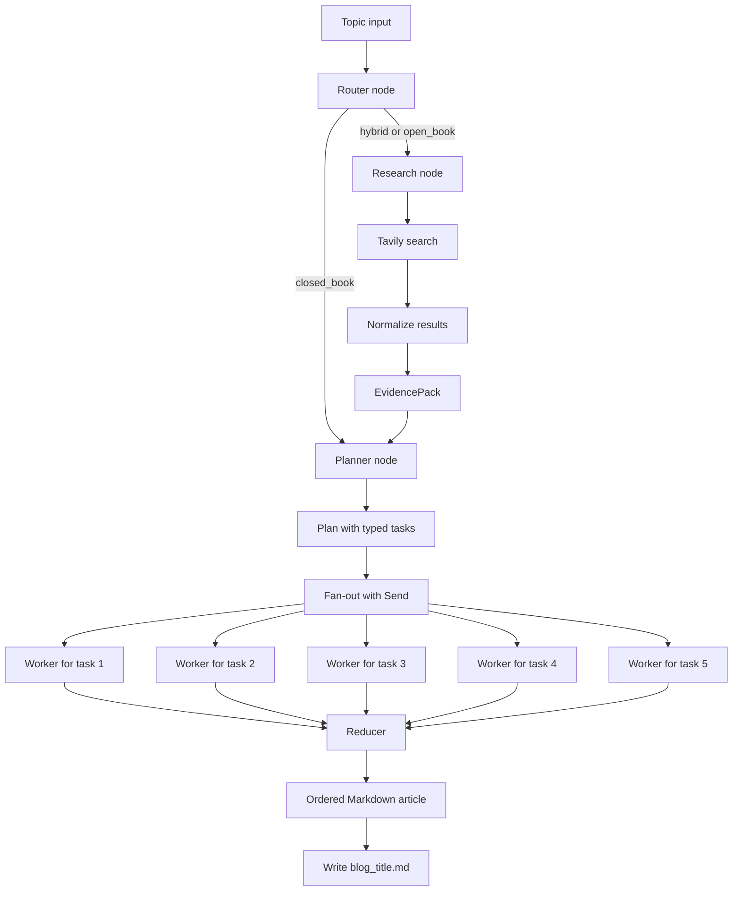

# Research Agent Guide 🔎

This guide explains [`_bwa_research.ipynb`](_bwa_research.ipynb), the research-aware version of the Blog Writing Agent.

It is designed for topics where the answer may depend on recent releases, current tools, prices, policies, or market changes. The workflow uses Groq for planning and writing, Tavily for web search, and LangGraph for routing and parallel section generation.

## What This Notebook Does ✨

Input:

```json
{
    "topic": "Top models in 2026"
}
```

Output:

- a research decision;
- search queries;
- normalized evidence records;
- a typed blog plan;
- one Markdown section per planned task;
- a final Markdown article saved to disk.

This notebook does not generate images. For image planning and image fallback behavior, use [`_bwa_with_image.ipynb`](_bwa_with_image.ipynb).

## Research Flow Diagram 🧭



## Stage-by-Stage Explanation 📚

### Stage 1: User input

Example input:

```json
{
    "topic": "Top models in 2026"
}
```

Initial state contains the topic and empty values for mode, queries, evidence, plan, sections, and final output.

Expected state shape:

```json
{
    "topic": "Top models in 2026",
    "mode": "",
    "needs_research": false,
    "queries": [],
    "evidence": [],
    "plan": null,
    "sections": [],
    "final": ""
}
```

### Stage 2: Router node 🚦

The router reads the topic and returns a structured `RouterDecision`.

Example input to the router:

```text
Topic: Top models in 2026
```

Example output:

```json
{
    "needs_research": true,
    "mode": "hybrid",
    "queries": [
        "Which leading LLMs are available in 2026?",
        "What architecture and deployment trends define LLMs in 2026?",
        "How do current model pricing and context windows compare?"
    ]
}
```

The router uses three modes:

| Mode | Meaning | Next stage |
| --- | --- | --- |
| `closed_book` | Evergreen information is sufficient. | Planner |
| `hybrid` | Current evidence improves an otherwise evergreen article. | Research, then planner |
| `open_book` | The article is mainly time-sensitive news or a roundup. | Research, then planner |

### Stage 3: Research node 🌐

When `needs_research=True`, the research node sends selected queries to Tavily.

The current notebook intentionally uses a small research budget:

```json
{
    "research_query_limit": 2,
    "results_per_query": 1
}
```

So the router may propose many queries, while the actual run uses only the first two queries and one result per query.

Example raw search result:

```json
{
    "title": "Current LLM model overview",
    "url": "https://example.com/llm-overview",
    "content": "A short source summary...",
    "published_date": null
}
```

The node normalizes that result into an `EvidenceItem`:

```json
{
    "title": "Current LLM model overview",
    "url": "https://example.com/llm-overview",
    "snippet": "A short source summary...",
    "published_at": null,
    "source": null
}
```

The research node then deduplicates evidence by URL and returns:

```json
{
    "evidence": [
        {
            "title": "Current LLM model overview",
            "url": "https://example.com/llm-overview",
            "snippet": "A short source summary..."
        }
    ]
}
```

### Stage 4: Orchestrator node 🧠

The planner receives the topic, selected mode, and evidence. It returns a typed `Plan`.

Example planner input:

```text
Topic: Top models in 2026
Mode: hybrid
Evidence: current LLM model overview, architecture overview
```

Example plan output:

```json
{
    "blog_title": "Top LLM Models in 2026: A Developer's Guide",
    "audience": "Developers",
    "tone": "Professional and practical",
    "blog_kind": "explainer",
    "tasks": [
        {"id": 1, "title": "Model landscape", "target_words": 160},
        {"id": 2, "title": "Choosing a model", "target_words": 180},
        {"id": 3, "title": "Integration example", "target_words": 200},
        {"id": 4, "title": "Performance and cost", "target_words": 180},
        {"id": 5, "title": "Production observability", "target_words": 170}
    ]
}
```

Each task contains:

- `goal`: what the reader should understand;
- `bullets`: concrete points the worker must cover;
- `target_words`: approximate section length;
- `tags`: topic labels;
- `requires_research`: whether the task depends on current evidence;
- `requires_citations`: whether source URLs should be cited;
- `requires_code`: whether a code example is expected.

### Stage 5: Fan-out and workers ⚙️

The `fanout` function sends one payload per task using LangGraph `Send`.

Example worker payload:

```json
{
    "task": {
        "id": 3,
        "title": "Integration example",
        "goal": "Show how to call a selected model safely.",
        "bullets": ["Create a client", "Stream output", "Handle 429 errors"],
        "target_words": 200,
        "requires_code": true
    },
    "topic": "Top models in 2026",
    "mode": "hybrid",
    "plan": "...",
    "evidence": []
}
```

The worker returns one tuple:

```json
{
    "sections": [
        {
            "task_id": 3,
            "markdown": "## Integration Example\n\nHere is a concise implementation..."
        }
    ]
}
```

The section ID is important because workers may finish in a different order from the plan.

### Stage 6: Reducer node 🧩

The reducer sorts sections by task ID, joins them with blank lines, creates a title, and writes a Markdown file.

Example reducer input:

```json
{
    "plan": "...",
    "sections": [
        {"task_id": 2, "markdown": "## Choosing a Model\n..."},
        {"task_id": 1, "markdown": "## Model Landscape\n..."},
        {"task_id": 3, "markdown": "## Integration Example\n..."}
    ]
}
```

Example reducer output:

```json
{
    "final": "# Top LLM Models in 2026: A Developer's Guide\n\n## Model Landscape\n...\n\n## Choosing a Model\n...\n\n## Integration Example\n...\n"
}
```

The file is saved using a safe title-based name, for example:

```text
top_llm_models_in_2026_a_developer_s_guide.md
```

## Complete Example Summary ✅

For this input:

```json
{
    "topic": "Top models in 2026"
}
```

A successful run should look conceptually like this:

```text
Input
  topic = "Top models in 2026"

Router
  mode = "hybrid"
  needs_research = True
  queries = [...]

Research
  evidence = [EvidenceItem(...), EvidenceItem(...)]

Planner
  plan.tasks = 5

Workers
  sections = [(1, "## ..."), (2, "## ..."), ...]

Reducer
  final = "# Top LLM Models in 2026: A Developer's Guide..."
  file = "top_llm_models_in_2026_a_developer_s_guide.md"
```

If the router returns `closed_book`, the research stage is skipped and the planner runs directly.

## Setup and Run 🚀

1. Create a Python 3.14+ environment.
2. Install dependencies:

   ```bash
   pip install -r requirements.txt
   ```

3. Create `.env` in the project directory:

   ```env
   GROQ_API_KEY=your_groq_key
   TAVILY_API_KEY=your_tavily_key
   ```

4. Open [`_bwa_research.ipynb`](_bwa_research.ipynb) in VS Code.
5. Run the definition cells from top to bottom.
6. Run the final cell:

   ```python
   run("Top models in 2026")
   ```

The output Markdown file is written to the notebook kernel's current working directory.

## Important Limitations ⚠️

- The current research node uses only two queries and one result per query to control cost and token usage.
- Research evidence can be empty when Tavily returns no results or when the API key is unavailable.
- Fresh claims should be reviewed by a human before publication.
- Worker output is generated text and may be incomplete or contain incorrect code.
- The notebook's shared Groq client currently uses `max_tokens=5000`, which can trigger TPM errors when several worker calls run close together. Reduce this value or use a smaller worker-specific limit if rate limits occur.
- This older research notebook does not include the newer image-planning stage.

## Troubleshooting Q&A 🛠️

### Q1. Why does the router choose `hybrid` or `open_book`?

The router detects that the topic depends on recent facts, releases, prices, regulations, or rankings. Use a timeless topic for `closed_book`; use research modes when current evidence matters.

### Q2. Why is `evidence` empty?

Check `TAVILY_API_KEY`, internet access, and the Tavily package installation. The search may also return no usable URLs. The planner can still run, but fresh claims will not be grounded.

### Q3. Why are there many queries but only one or two evidence items?

The notebook deliberately slices the list with `state["queries"][:2]` and requests one result per query. This is a cost and token-control setting, not necessarily a search failure.

### Q4. Why does Groq return a `429` token-per-minute error?

The shared model allows up to 5,000 output tokens and workers can run close together. Wait for the retry period, avoid repeated runs, and reduce `max_tokens` or add a worker-specific lower limit.

### Q5. Why is the final article shorter or missing a section?

A worker may return an empty or incomplete section. Inspect `sections` before using `final`. Add a retry for empty content or validate that every planned task has a non-empty Markdown section.

### Q6. Why is the output file saved somewhere unexpected?

The reducer uses `Path.cwd()`. Check the notebook kernel's current working directory and open the generated file from that location.

### Q7. Why are citations missing or malformed?

Workers can cite only URLs present in `evidence`. If evidence is empty, no reliable citation can be produced. Also inspect generated Markdown links because model output may need light cleanup.

### Q8. Why does a generated code example not run immediately?

The worker may use an illustrative provider URL, incomplete authentication, or a response format different from the selected API. Treat generated code as a starting point and test it against the real provider documentation.

## Related Files 📁

| File | Purpose |
| --- | --- |
| [`_bwa_research.ipynb`](_bwa_research.ipynb) | Research-aware router, Tavily evidence, planner, workers, and reducer. |
| [`_bwa_with_image.ipynb`](_bwa_with_image.ipynb) | Newer workflow with image planning and image-generation fallback. |
| [`README_BLOG_WRITING_AGENT.md`](README_BLOG_WRITING_AGENT.md) | Guide to the current image-enabled workflow. |
| [`requirements.txt`](requirements.txt) | Python dependencies. |
| [`pyproject.toml`](pyproject.toml) | Project metadata and dependency declarations. |
